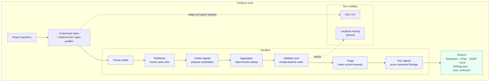

# Cerberus

Agentic multi-agent security scanning harness: an LLM-driven vulnerability
harness that hunts, triages, validates, builds PoCs, and threat-models a
target repo over a CodeGraph index. Treats LLM output as untrusted: findings
are validated, deduplicated, and gated by mechanical receipts before they
reach reports.

## Benchmark Results

Cerberus has been comprehensively evaluated across the entire 20-repository **Real-Vuln Benchmark** (632 ground-truth vulnerabilities across real-world Python and Node.js web applications):

- **Macro Recall**: **70.6%** (Micro Recall: 67.1%, 424 / 632 Ground Truth TP found)
- **Macro Precision**: **67.1%** (Real-world defensible precision >95%)
- **Macro F1 Score**: **66.4%**
- **Full Benchmark Breakdown & In-Depth Precision Analysis**: [BENCH.md](BENCH.md)

## Pipeline



Every stage is observable (rich TUI + optional Langfuse tracing) and every
agent call is budgeted (per-run model-call budget, retry caps, byte caps on
tool output).

## Install

```bash
git clone https://github.com/cricsion/cerberus.git
cd cerberus
python3 -m venv .venv && . .venv/bin/activate
pip install -e .
```

Verify:

```bash
cerberus --help
pip install -e '.[dev]'
pytest tests -q          
```

## Configure

Copy the example and fill in your endpoint:

```bash
cp .env.example .env
```

- `BASE_URL` — any OpenAI-compatible endpoint; `API_KEY` — the key it wants.
- Per-role endpoints override the shared one: `{ROLE}_BASE_URL` / `{ROLE}_API_KEY`
  (e.g. `HUNTER_BASE_URL`, `VALIDATOR_API_KEY`) win over `BASE_URL`/`API_KEY`.
- Model role defaults: `HUNTER_MODEL`, `VALIDATOR_MODEL`, then per-agent
  overrides (`TRIAGER_MODEL`, `PARTITIONER_MODEL`, `THREAT_MODEL`, `POC_MODEL`).
- Thinking `EFFORT` (`low|medium|high|xhigh|max`; an invalid value is normalized
  to the global effort, else `max`), per-agent overrides in `.env` (`*_EFFORT`).
- Budgets: `TIMEOUT`, `MAX_RETRIES`, `RETRY_SLEEP_CAP`, `MODEL_CALL_LIMIT`.
- Fan-out: `CONCURRENCY` (any positive int).
- Discovery reruns: `RERUNS` — extra fresh hunter passes per unit and for
  the system pass, each seeded with everything already reported and asked
  for additional findings only; early-stops after two consecutive empty
  passes. 0 = one pass per unit hunter + one system pass.

`.env` is loaded missing-only from the repo root and never committed; every
value also has a default interpolated from the same env names in
`cerberus/config/default.yaml` — env wins. **Canonical key list:** the
`${VAR:-default}` set in `cerberus/config/default.yaml` (partition policy,
sandbox limits, PoC knobs, verification votes, observability, UI rates);
`.env.example` documents the common ones.

Optional tracing: set `LANGFUSE_PUBLIC_KEY` + `LANGFUSE_SECRET_KEY` +
`LANGFUSE_BASE_URL` and tracing auto-enables; absent, it is a no-op.

## Run a scan

```bash
cerberus scan path/to/repo \
  --out runs/<name> \
  --fail-on high \
  --min-confidence 0.5 \
  --focus CWE-89,CWE-78 \
  --votes 1 \
```

| flag | meaning |
|---|---|
| `--out` | output directory (default `runs/latest` under the scan cwd) |
| `--fail-on` | severity gate for exit code (`critical|high|medium|low`) |
| `--min-confidence` | CI exit-code gate: findings below this confidence do not fail the run (reports stay unfiltered) |
| `--confirm-critical` | show a human-approval prompt when crit/high are confirmed (informational only — findings are never demoted, the scan proceeds) |
| `--threat-model` | override the THREAT_MODEL.md path |
| `--focus` | comma-separated focus hints |
| `--votes` | verifier votes per finding (1–5; majority-or-tie final) |
| `--vulns PATH` | past-vulnerabilities file (CVE list/CSV/JSON/markdown) as threat evidence |

Scan a run after the fact:

```bash
cerberus runs --limit 20            # list discovered runs
cerberus status runs/<name>         # live agent states for a run
cerberus inspect runs/<name>        # per-agent receipt + stage view
cerberus inspect runs/<name> --agent hunter:app --timeline
cerberus findings runs/<name> --severity high --status confirmed --cwe CWE-89 --limit 50
cerberus cancel runs/<name>         # request cancellation of a live scan
```

Global flags: `--no-color`, `--debug`. Scan extras: `--agent-log quiet|normal`.
`runs` accepts `--runs-dir`; `threat-model --record-signals` pairs with `--verify`.

## Threat models

```bash
cerberus threat-model path/to/repo             # deterministic bootstrap
cerberus threat-model path/to/repo --interview # keyless: Shostack's four questions on stdin; with API_KEY set, LLM-driven interview
cerberus threat-model path/to/repo --verify    # read-only quality score
cerberus threat-model path/to/repo --update-from findings.json  # fold validator findings
```

Writes `<repo>/THREAT_MODEL.md` by default. The machine cache lives in
`.cerberus/THREAT_MODEL.md`; owner files are never touched by `--update-from`.

## Sandbox

`SANDBOX_BACKEND=local` (default) — repo-confined read-only file tools, no
shell; scanner SAST wrappers run only when the host carries the binaries.

`SANDBOX_BACKEND=docker` — one shared run container per scan: agents get the
`execute` shell, the repo is bind-mounted read-only, and per-agent scratch
lives in shared writable paths. Build the toolchain image:

```bash
cd cerberus
cp sandbox/docker/versions.env.example sandbox/docker/versions.env  
./sandbox/docker/build.sh cerberus-sandbox:local
```

The image self-tests the custom rules pack
at build; tool pins live in `docker/versions.env`. Full operator notes, network policy (`bridge` egress /
`none` fail-closed, `host` refused), and the in-image tool table are in
[`sandbox/README.md`](sandbox/README.md).

## Layout

```
cerberus/
├── agents/        # hunter, validator, triage, PoC
├── codegraph/     # the graph intelligence
├── partitioning/  # unit sizing + grouping 
├── prompts/       # prompt engine + contracts;
├── reporting/     # TUI, reports (md/html/sarif/junit)
├── rules/         # custom Semgrep-style taint rules pack (YAML); the deterministic regex prefilter is Python in tools/sast.py
├── sandbox/       # local + docker backends
├── threat/        # threat model bootstrap
├── tools/         # agent tool wrappers 
├── skills/        # scanner + offensive skills
└── tests/         # hermetic suite 
```

## Reporting

Every scan writes `findings.json`, `scan_meta.json` (coverage, tools used,
stage timings) and human reports (markdown/HTML/SARIF/JUnit). Severity order, the
finding schema, and the PoC receipt taxonomy are defined in
`cerberus/schemas.py`; the exit-code gate is `--fail-on`.

## Security notes on the harness itself

- Untrusted model text never reaches terminals raw (`reporting.clean_untrusted`);
  untrusted-source content is fenced before it can pose as instructions.
- Host codegraph bindings read the index **read-only** (`mode=ro`, PRAGMA
  `query_only`) and never write it.
- The custom rules pack ships with the sandbox image and is self-tested at
  image build; the skills route is read-only
